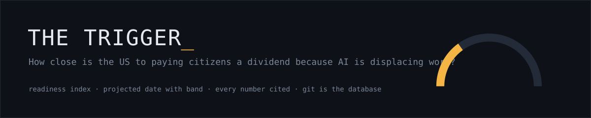
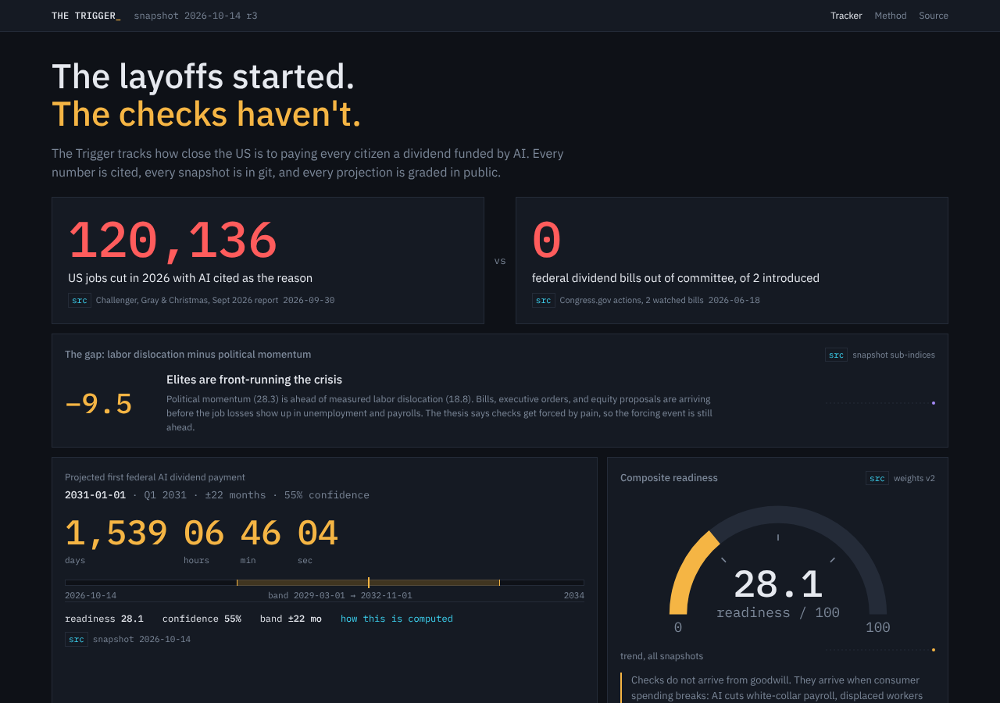

<p align="center"></p>

<p align="center">
  <a href="https://destinjones.github.io/the-trigger/"></a>
  <a href="https://github.com/destinjones/the-trigger/actions/workflows/ci.yml"></a>
  <a href="https://github.com/destinjones/the-trigger/actions/workflows/snapshot.yml"></a>
  <a href="LICENSE"></a>
</p>

**Live tracker:** https://destinjones.github.io/the-trigger · **What you'd get:** [/calculator](https://destinjones.github.io/the-trigger/calculator) · **What moved:** [/log](https://destinjones.github.io/the-trigger/log) ([RSS](https://destinjones.github.io/the-trigger/rss.xml)) · **Method and weaknesses:** [/method](https://destinjones.github.io/the-trigger/method) · **Data:** [/data](https://destinjones.github.io/the-trigger/data) · **Our record:** [SCOREBOARD.md](SCOREBOARD.md)

**The layoffs started. The checks haven't.** The Trigger tracks how close the United States is to paying its citizens a dividend because AI is displacing work, and projects when the first federal check clears. It boils six sub-indices (labor dislocation, political momentum, public opinion, corporate equity, precedent and fiscal pressure) into one 0–100 readiness score and a projected date for the first federal AI dividend, always shown with its band and confidence. The thesis is blunt: checks do not arrive from goodwill, they arrive when consumer spending breaks. So the tracker watches the dislocation and the political response side by side, and treats the gap between them as the story. Every number links to the upstream record it came from, the weighting is a YAML file you can fork, and every projection is logged and graded.



## Quickstart

```sh
nvm use            # Node 22.12+
corepack enable    # pnpm
pnpm install
pnpm test          # model, sources (against recorded upstream responses), scorecard
pnpm snapshot      # pull every source, write data/YYYY-MM-DD.json
pnpm scorecard     # log the projection, regenerate SCOREBOARD.md
pnpm health        # failed or skipped sources, curated files about to expire
pnpm dev           # http://localhost:4321
pnpm build         # static site in web/dist
```

No keys are required. Optional keys raise rate limits or turn on extra sources; copy `.env.example` and see [DATA_LICENSE.md](DATA_LICENSE.md).

Rebuild the first snapshot from recorded upstream bytes, without the network:

```sh
pnpm snapshot -- --date 2026-10-14 --replay fixtures/cassettes/2026-10-14.json --revise --dry-run
```

## How it works

| Piece | Where |
|---|---|
| Weighting, with a comment on every line | [`index/weights.v2.yaml`](index/weights.v2.yaml) (default; [v1](index/weights.v1.yaml) still runs). Every change and why: [WEIGHTS.md](WEIGHTS.md) |
| Per-metric 0–100 transforms and their reasoning | [`index/normalize.ts`](index/normalize.ts) |
| Composite and projection (pure, tested) | [`index/model.ts`](index/model.ts) |
| One module per source, one interface | [`sources/`](sources) |
| Hand-curated sources with no API (Challenger, polls, pilots) | [`sources/curated/`](sources/curated) |
| Daily snapshots: git history is the time series | [`data/`](data) |
| Prediction ledger | [`predictions/ledger.json`](predictions/ledger.json) |
| Daily job, and the `pipeline-health` issue it keeps current | [`.github/workflows/snapshot.yml`](.github/workflows/snapshot.yml) |
| Static JSON for anyone to reuse | [`/api/latest.json`](https://destinjones.github.io/the-trigger/api/latest.json), [`/api/history.json`](https://destinjones.github.io/the-trigger/api/history.json) |

Design rules: git is the database (no backend, nothing fetched in the browser); past snapshots are never rewritten, corrections are new revisions; no number without a source link; the model is deterministic and never reads the clock; the index is arguable, so weights live in data, not code.

## Argue with the index

1. Copy `index/weights.v2.yaml` to `weights.v3.yaml` and change what you disagree with. Say why in the comments.
2. `pnpm snapshot -- --weights v3 --dry-run` to see your score and date.
3. Open a pull request with the result.

Disagree with an anchor instead (say, 9% unemployment as "trigger pulled")? Edit `index/normalize.ts`; the tests tell you what moved.

## Contributing

See [CONTRIBUTING.md](CONTRIBUTING.md): fixing a curated value or adding a poll takes one YAML edit. Issues labelled [good first issue](https://github.com/destinjones/the-trigger/labels/good%20first%20issue) are scoped for a first pull request. Changes are listed in [CHANGELOG.md](CHANGELOG.md); please read the [code of conduct](CODE_OF_CONDUCT.md), and report security problems privately ([SECURITY.md](SECURITY.md)).

If you use the data, cite it with [CITATION.cff](CITATION.cff) and the snapshot date.

## Sources

Tier 1: BLS, Congress.gov, FRED, Federal Register (GovTrack retired 2026-10-15 after its API returned 502 throughout). Tier 2: guaranteed-income pilot records, national polling, LegiScan, SEC EDGAR (AI capex vs headcount, parsed from 10-Ks), corporate equity commitments. Tier 3: Challenger AI-attributed layoffs, Kalshi. Any source can fail without breaking the run: its last value is carried forward and marked stale. Details and terms in [DATA_LICENSE.md](DATA_LICENSE.md).

## Deploy

`deploy.yml` builds the static site and publishes it to GitHub Pages on every push and after every snapshot (enable Pages with source "GitHub Actions" in the repo settings). Set `CLOUDFLARE_API_TOKEN` and `CLOUDFLARE_ACCOUNT_ID` to also publish to Cloudflare Pages. Either way it costs $0.

## Roadmap (out of scope for v0.1)

- State-level map (LegiScan data is already recorded)
- Anthropic Economic Index task-exposure source
- Polymarket alongside Kalshi
- Email or RSS alerts on threshold crossings
- Accounts, a database, i18n, mobile app: not planned unless there is a reason

## License

Code: MIT. Data: each upstream source keeps its own terms; see [DATA_LICENSE.md](DATA_LICENSE.md). Nothing here is financial or policy advice.
